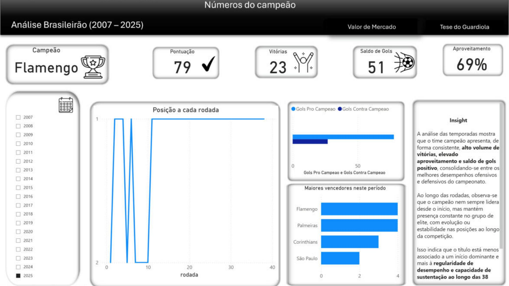
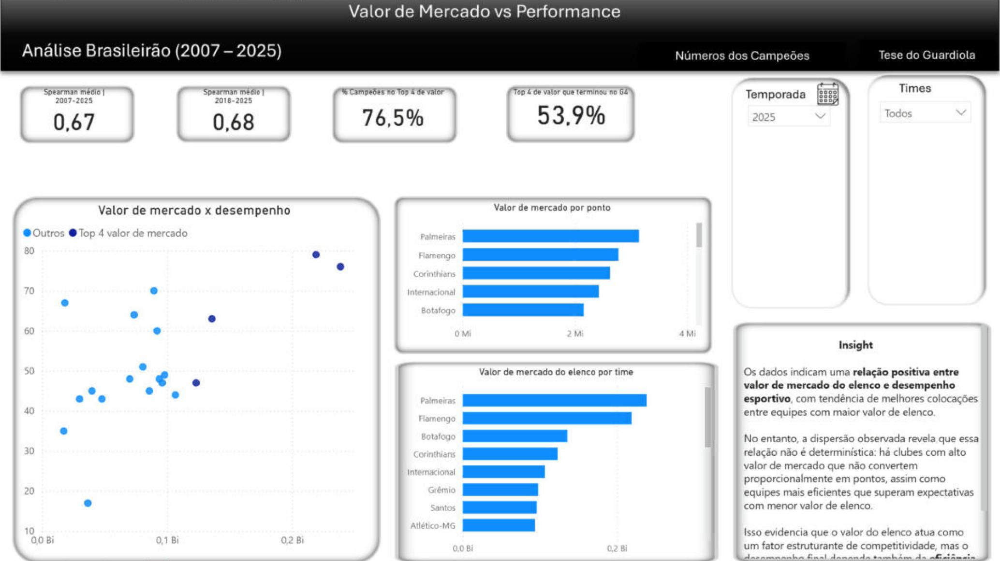
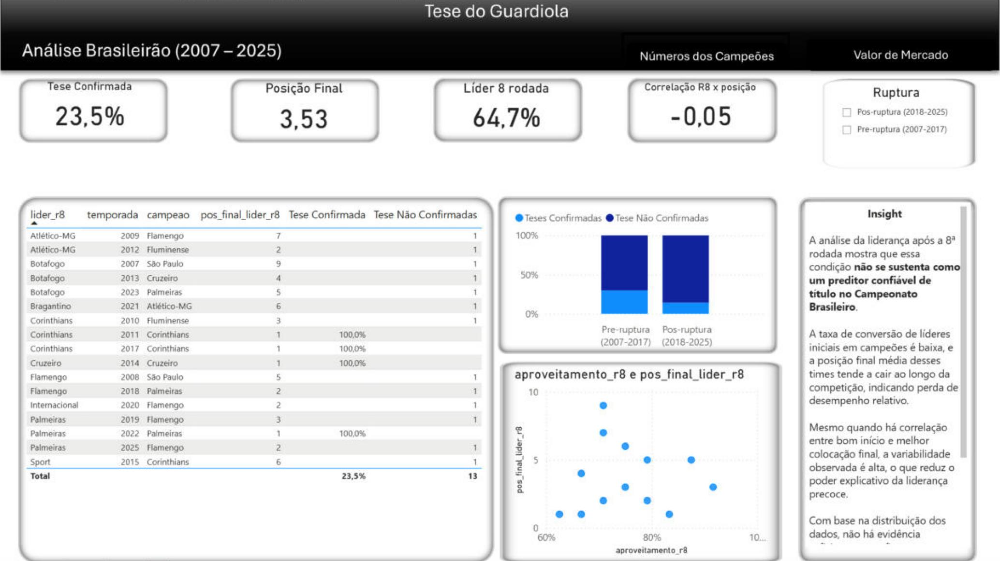

# Análise do Campeonato Brasileiro (2007–2025)


Pipeline em Python que transforma resultados de partidas do Brasileirão em tabelas analíticas
consumidas pelo Power BI. Responde a duas perguntas: **elencos mais valiosos terminam mais
acima na tabela?** e **o líder após a 8ª rodada costuma ser campeão?**

## Demonstração

Dashboard em Power BI com três páginas:

| Página | O que mostra |
|---|---|
| Números do campeão | campeão, pontos, vitórias, saldo e posição rodada a rodada |
| Valor de Mercado vs Performance | Spearman por período, campeões no top 4 de valor, valor do elenco por time |
| Tese do Guardiola | líder da 8ª rodada: quantas vezes foi campeão e onde terminou |





## Tecnologias

Python (pandas, numpy, scipy), pytest e Power BI Desktop.

## Arquitetura

```text
dados/raw/*.csv  →  python -m src.pipeline  →  dados/processed/*.csv  →  Power BI
```

| Pasta | Conteúdo |
|---|---|
| `src/` | leitura, normalização, fato, qualidade e estatística |
| `tests/` | testes automatizados |
| `dados/` | brutos e processados |
| `bi/` | `verdadeiro.pbix` e as imagens de fundo das páginas (`fundos/`) |
| `docs/fontes.md` | origem de cada dado e limitações |
| `documentacao.md` | dicionário de dados |

## Pré-requisitos e instalação

```bash
pip install -r requirements-dev.txt
```

## Como executar

```bash
python -m src.pipeline                      # estrito: falha se houver temporada incompleta
python -m src.pipeline --allow-incomplete   # gera as saídas e marca as limitações
pytest -q
```

No Power BI, abra `bi/verdadeiro.pbix`. As consultas apontam para um caminho local: em
**Transformar dados → Configurações da fonte de dados**, troque pela sua pasta
`dados/processed/` e clique em **Atualizar**.

## Funcionalidades

- **Qualidade de dados:** temporada completa exige 20 clubes, 38 rodadas e 380 jogos com placar.
  2016 e 2024 ficam fora das inferências.
- **Valor de mercado × desempenho:** Spearman **dentro de cada temporada** (17 temporadas):
  ρ médio de **0,67**, e **0,67 até 2017** contra **0,68 de 2018 em diante**. Não há queda
  depois de 2018.
- **Por que não Pearson:** a coluna de valor mistura escalas (2023–2024 em milhares; 2025 é valor
  de elenco em euros), o que distorcia a correlação. Detalhes em `docs/fontes.md`.
- **Campeões e valor de mercado:** 13 de 17 campeões (76%) estavam entre os 4 maiores valores
  de elenco da temporada.
- **Tese da 8ª rodada:** o líder após a 8ª rodada foi campeão em 4 de 17 temporadas válidas
  (24%; IC 95% de 10% a 47%). É um sinal fraco, não uma regra; com tão poucas temporadas o
  intervalo é largo. Antes de 2018 foram 3 de 10; de 2018 em diante, 1 de 7.

Limites: valor de mercado do elenco não é investimento realizado; a análise mede associação,
não causalidade; a origem de parte dos dados não está
registrada (`docs/fontes.md`).

## Contribuição

Issues e pull requests são bem-vindos. Rode `pytest -q` antes de abrir um PR.

## Autor e licença

**Renato Santos** · [GitHub](https://github.com/natoawayrj) ·
[LinkedIn](https://www.linkedin.com/in/renato-santos-dados/)

Licença: MIT (ver `LICENSE`).
